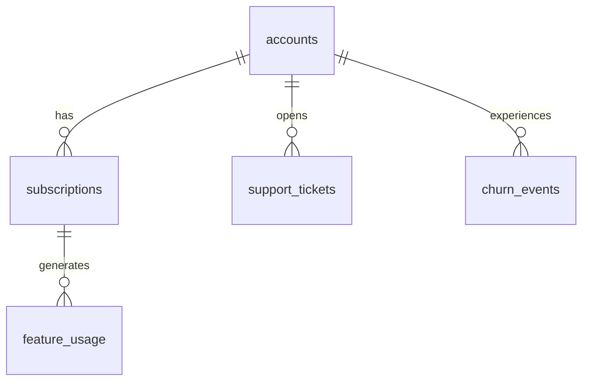
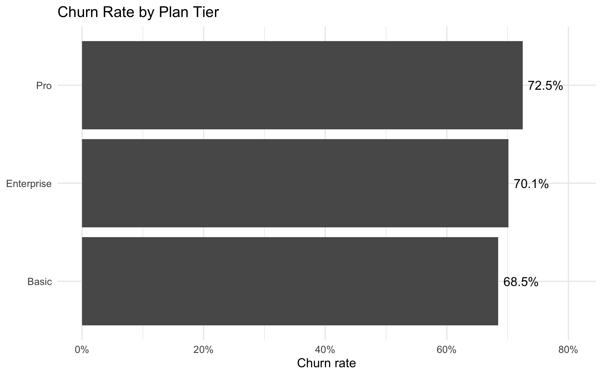
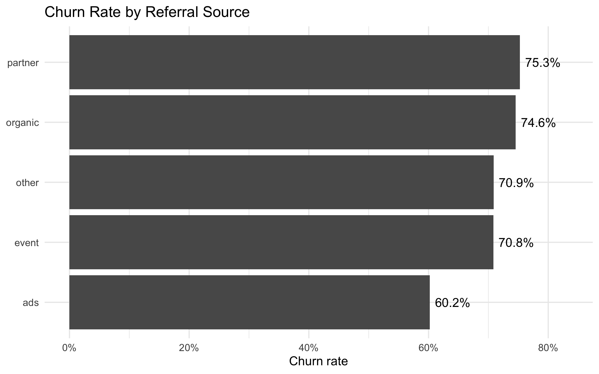
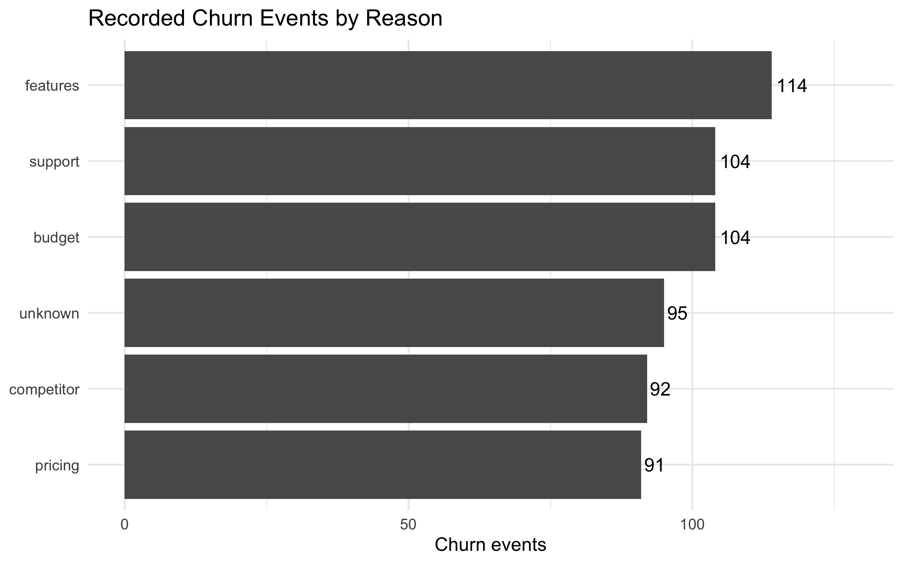
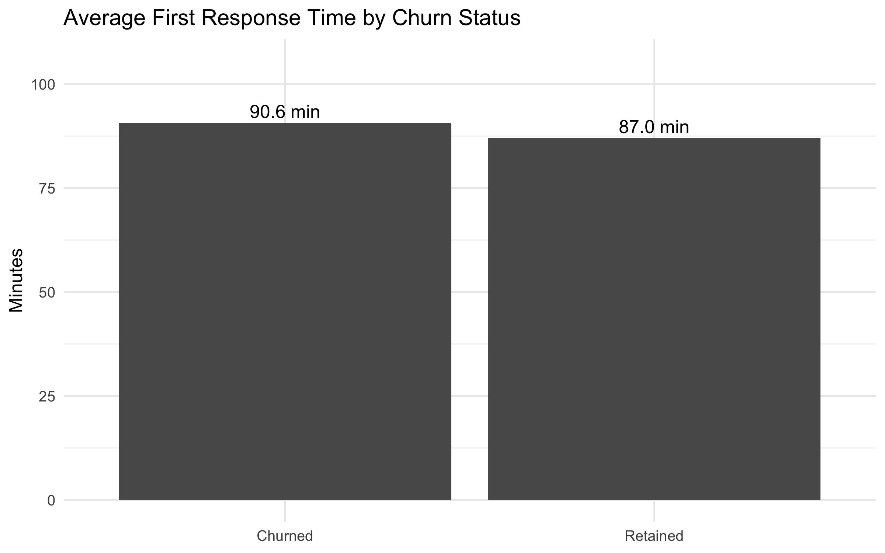
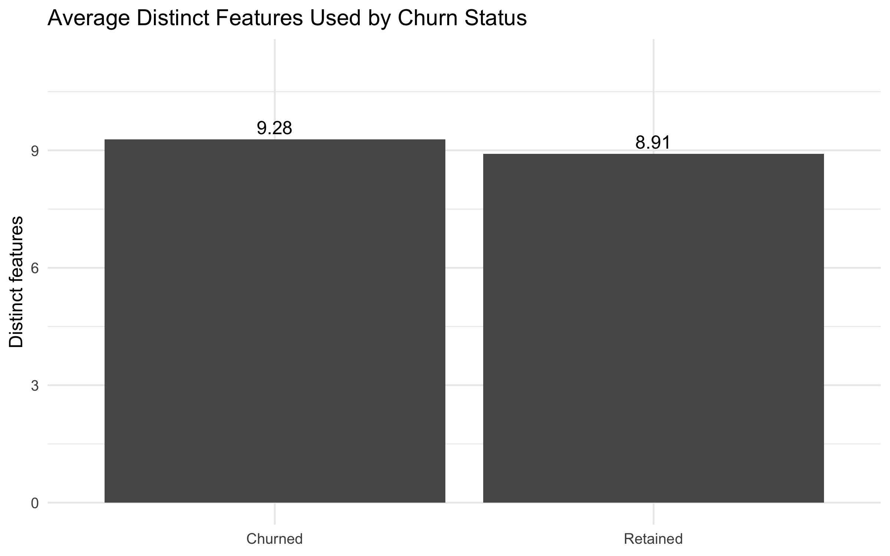

# RavenStack SaaS Subscription & Churn Analytics

## Project Overview

This portfolio project analyzes customer churn for **RavenStack**, a synthetic SaaS company. The analysis connects account characteristics, subscription history, product usage, support experience, and churn-event data in a relational SQLite database.

The objective is to understand **why customers cancel and which customer characteristics, support experiences, product-usage patterns, and subscription plans are associated with churn**. The primary stakeholder is the **Customer Success Manager**, with additional relevance to Product/Marketing, Sales, Finance, and leadership.

## Business Questions

1. What is RavenStack's analytical account-level churn rate?
2. Which plans and customer segments show the highest observed churn rates?
3. How does support experience differ between churned and retained accounts?
4. Is lower product engagement associated with churn?
5. What recurring-revenue exposure is associated with churn-classified accounts?
6. What churn reasons, reactivations, and preceding plan changes appear most often?

## Dataset

The project uses a five-table synthetic SaaS dataset:

- `accounts` — 500 customer accounts
- `subscriptions` — 5,000 subscription records
- `feature_usage` — 25,000 usage-event rows
- `support_tickets` — 2,000 support tickets
- `churn_events` — 600 churn-event records



## Tools & Technologies

- **Python / pandas** — pre-import data-quality assessment only
- **SQLite** — relational database
- **SQL / DBeaver** — database modeling, analytical views, joins, aggregation, and business analysis
- **R** — reproducible visualization script using SQL-exported result tables
- **Git/GitHub** — portfolio publishing and reproducibility

## Data Quality Assessment

The QA stage found several source issues that materially affect downstream analysis:

- 21 duplicated `usage_id` values affecting 42 feature-usage rows.
- 19,142 feature-usage rows occur before subscription start.
- 290 feature-usage rows occur after subscription end.
- 1,077 support tickets occur before account signup.
- 277 accounts are marked non-churned despite having a churn-event record.
- 35 accounts are marked churned without a churn-event record.

No raw records were deleted or overwritten. The database uses a surrogate `usage_event_key` for feature usage, while the original `usage_id` is retained for traceability. Behavioral analysis is restricted through SQL views to 5,568 temporally valid feature-usage rows and 923 valid support tickets.

## Analytical Methodology

The primary analytical churn definition is **event based**: an account is classified as churned when it has at least one record in `churn_events`. The original account churn flag is retained as `source_churn_flag` but is not used as the primary downstream indicator.

The analysis layer also normalizes blank values and boolean-like text imported into SQLite, then aggregates one-to-many support, usage, and subscription data to account level before joining to churn status. Full details are documented in [`docs/analysis_methodology.md`](docs/analysis_methodology.md).

## Key Results

| Metric | Result |
|---|---:|
| Analytical churn rate | **70.40%** |
| Churned accounts | **352 / 500** |
| Highest-churn plan | **Pro — 72.47%** |
| Highest-churn industry | **DevTools — 73.45%** |
| Highest-churn referral source | **partner — 75.28%** |
| Most common churn reason | **features — 114 events** |
| Reactivation-event rate | **10.17%** |
| Active MRR associated with churn-classified accounts | **$7,139,868** |

### Finding 1 — Referral source separates churn more than plan tier

Partner-referred accounts show a **75.28%** churn rate, while ads-referred accounts show **60.20%**. The **15.08-point** referral-source spread is much larger than the **4.02-point** spread across plan tiers.

### Finding 2 — Feature-related churn is the most common recorded reason

`features` accounts for **114 of 600 churn events (19.00%)**, making it the largest single reason category.

### Finding 3 — Support satisfaction does not strongly distinguish churned accounts

Average satisfaction is **3.97** for churned accounts versus **3.96** for retained accounts. Churned accounts do show slightly slower first response and resolution times, but the differences are modest.

### Finding 4 — Aggregate engagement is not lower for churned accounts

Churned accounts average **9.28** distinct features used versus **8.91** for retained accounts. This suggests that simple engagement volume alone is not an effective churn discriminator in this dataset.

### Finding 5 — Repeat lifecycle behavior matters

**61 churn events (10.17%)** are marked as reactivations, and **123 (20.50%)** follow an upgrade within 90 days.

## Visualizations

### Churn Rate by Plan Tier


### Churn Rate by Referral Source


### Recorded Churn Reasons


### Support Response Time by Churn Status


### Feature Engagement by Churn Status


## Business Recommendations

1. **Investigate feature-related churn with more granular exit feedback.** The `features` category is the largest recorded reason, but it is too broad to identify a specific product gap.
2. **Compare onboarding and customer fit by acquisition channel.** Partner and organic cohorts show higher observed churn than ads cohorts; this should be validated before making acquisition-spend decisions.
3. **Do not rely on support satisfaction alone as a churn signal.** Satisfaction is nearly identical across churn groups. Combine service metrics with lifecycle events, plan changes, and usage recency.
4. **Measure engagement trends rather than only totals.** Aggregate feature usage is not lower among churned accounts, so future work should test recency, declining activity, and pre-churn behavior windows.
5. **Strengthen upstream data controls.** Standardize SQL NULLs, boolean types, and temporal validation rules during ETL to reduce downstream correction logic.

## Limitations

- The dataset is fully synthetic, so results illustrate analytical workflow rather than real-world RavenStack performance.
- The source account churn flag conflicts materially with the detailed churn-event table.
- A large share of source support and feature-usage records violates expected temporal relationships and is excluded from behavioral analysis.
- Churn events are account level and are not directly linked to a specific subscription record.
- MRR/ARR figures are reported as **recurring-revenue exposure**, not realized revenue loss.
- The analysis is descriptive and does not establish causal relationships.

## Project Structure

```text
ravenstack_portfolio_final/
├── data/
│   ├── raw/
│   └── sql_output/
├── database/
│   └── ravenstack.db
├── docs/
│   ├── analysis_methodology.md
│   ├── data_dictionary.md
│   ├── key_findings.md
│   └── source_dataset_README.md
├── notebooks/
│   └── 01_data_quality_assessment.ipynb
├── output/
│   ├── figures/
│   └── qa/
├── r/
│   └── 01_visualizations.R
├── sql/
│   ├── 01_create_tables.sql
│   ├── 03_analysis_views.sql
│   ├── 03_churn_definition_review.sql
│   └── 04_churn_analysis.sql
├── README.md
└── requirements.txt
```

## How to Reproduce

1. Open `database/ravenstack.db` in SQLite/DBeaver.
2. Run `sql/03_analysis_views.sql` to rebuild the analytical views if needed.
3. Run `sql/04_churn_analysis.sql` for the complete business analysis.
4. The selected result sets used for the portfolio are stored in `data/sql_output/`.
5. Run `r/01_visualizations.R` from the repository root to recreate the visualization files in `output/figures/`.

## Data Source & Credit

Synthetic RavenStack SaaS dataset created by **River @ Rivalytics**. The source dataset permits educational and portfolio use with author credit. The original source documentation is preserved in `docs/source_dataset_README.md`.
